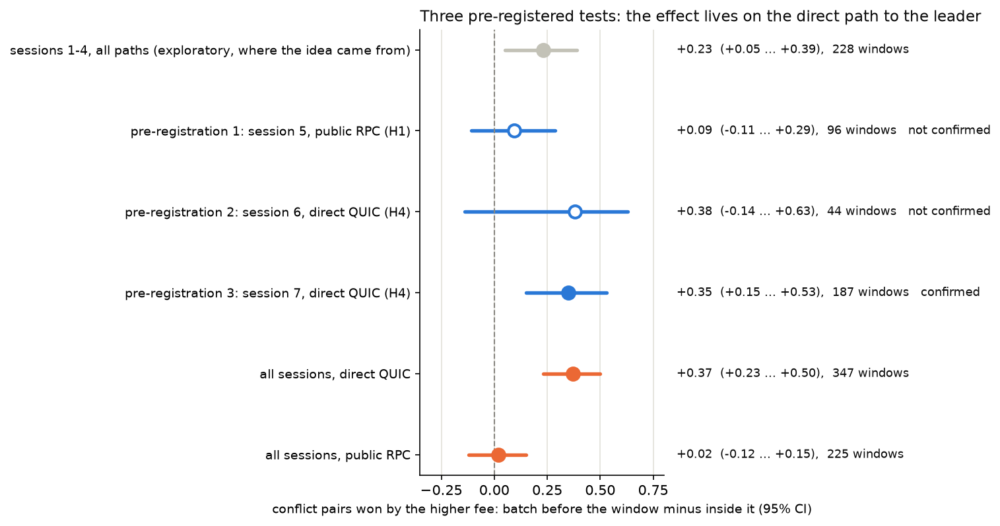
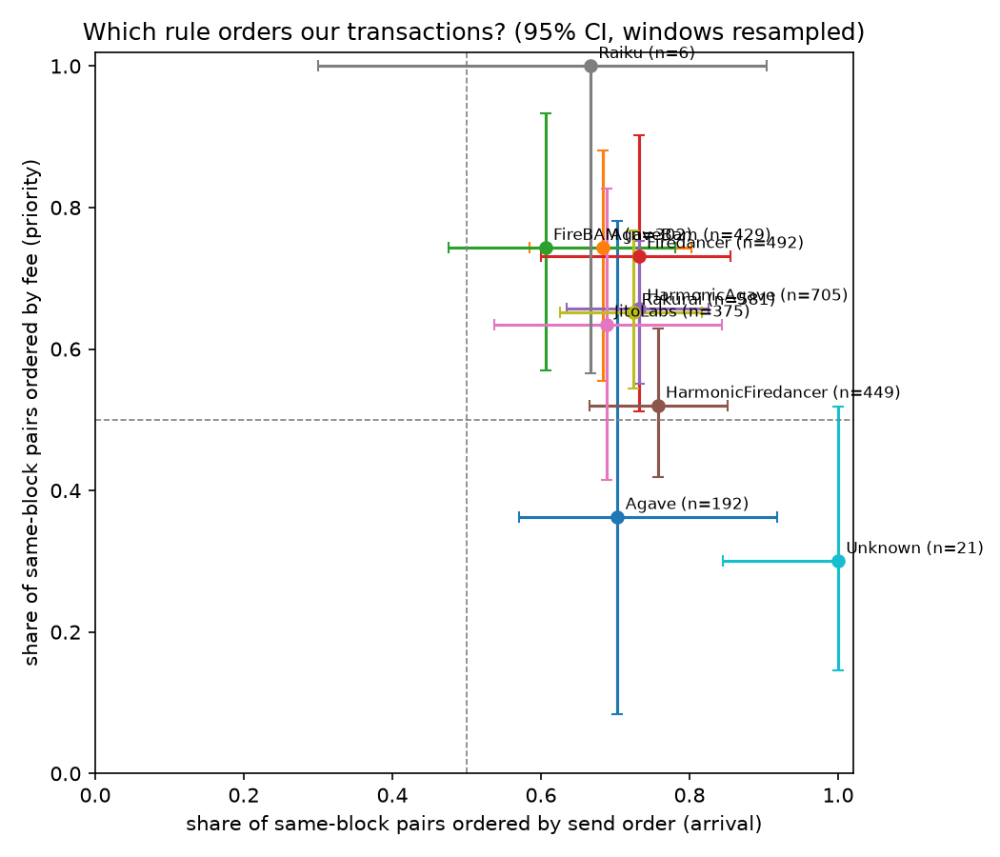
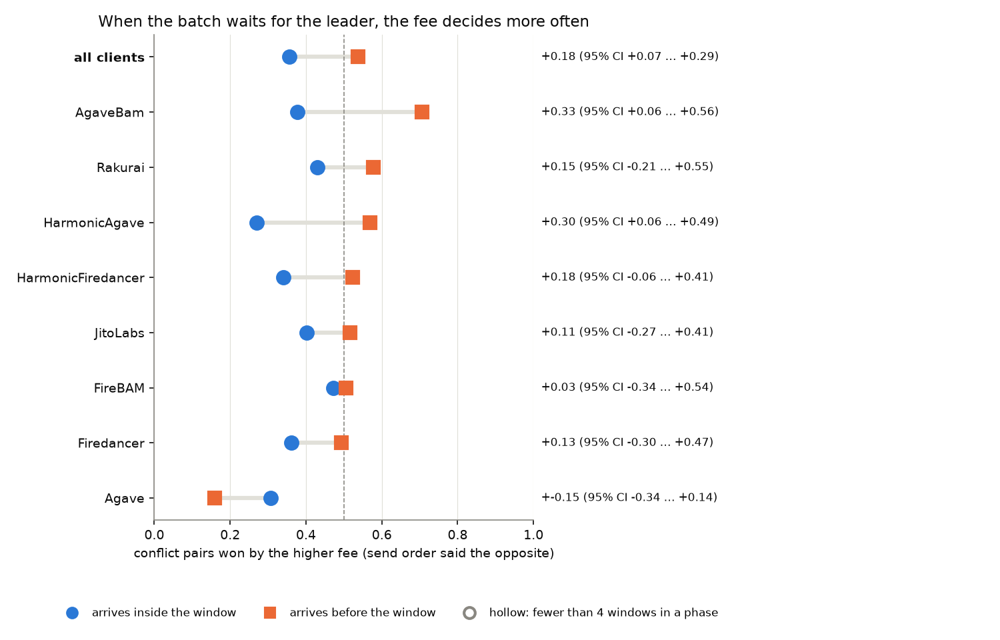
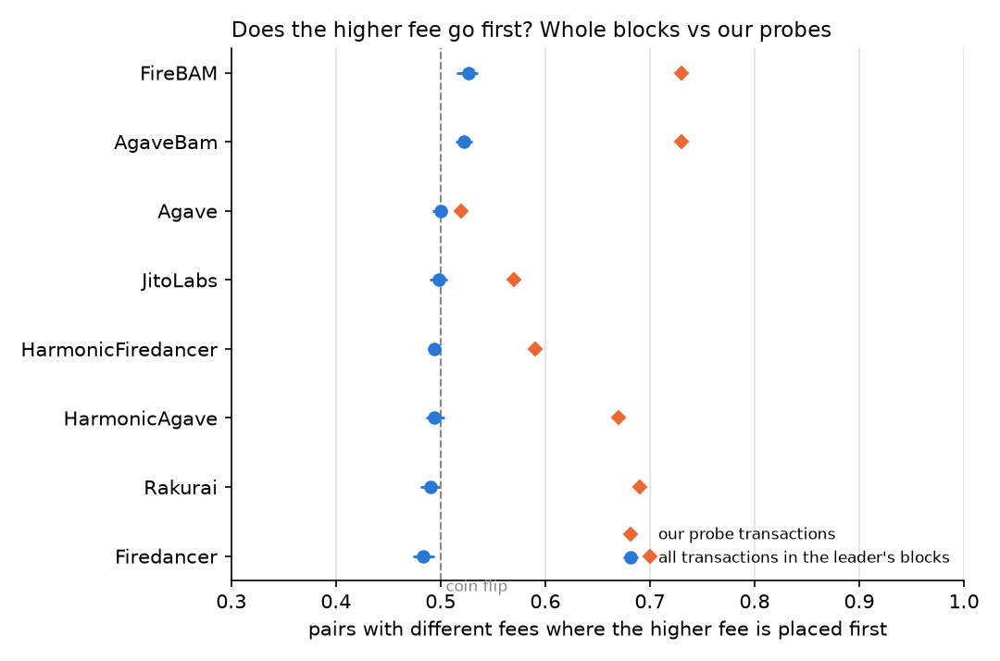

# Inside the Block: how Solana leaders order our transactions

**Study period:** 30 October – 4 November 2026 (devnet tests 30.10–1.11, mainnet 2–4.11). Every
mainnet measurement was taken after the Alpenglow upgrade of 21 October; nothing from before it is
mixed in. **Mainnet data:** 7 sessions, 607 leader windows of 174 validators running 10 clients,
6,132 of our own transactions, 3,595 landed (2,650 in the scheduled leader's own blocks).
**Cost:** 0.0209 SOL in fees for the whole study (budget about 0.05 SOL; the spend cap in the code is
0.045 SOL counted on the *maximum possible* fee). Every number below is rebuilt from `data/` by the
commands in [Reproduce](#reproduce).

## The answer in one paragraph

No client we measured orders our transactions by one strict rule. Both send order and priority fee
matter, with almost equal weight, for every client. What decides which of the two wins is mostly
**when the transactions reach the leader**: a batch that is already waiting when the leader's window
starts is sorted by fee (the higher fee wins 67% of conflicts), a batch that arrives during the
window is mostly taken in arrival order (the higher fee wins 32%). This was found in the first data,
tested three times with pre-registered tests, and **confirmed in the third** (session 7: +0.35, 95%
CI +0.15 … +0.53). It holds only on the direct path to the leader: through a public RPC the timing
is washed out (+0.02, CI −0.12 … +0.15). A second, independent view, the order of all ~444,000
other transactions in the same leaders' blocks, agrees: across a whole block the fee barely
predicts position.



## Findings

### 1. No strict rule; arrival and fee both matter, for every client

Same-block pairs of our transactions, all 7 sessions, 8,437 pairs from 335 windows:

* 70% follow send order (95% CI 67–73%), 67% follow the fee (64–71%);
* when the two disagree (3,423 conflict pairs), the fee wins 48% (42–53%);
* a pairwise logistic model gives weights of **0.98 ± 0.02 for send order and 0.92 ± 0.02 for the
  fee**.

| client | validators | windows | same-block pairs | follows send order | follows fee | fee wins conflicts | verdict |
|---|---:|---:|---:|---:|---:|---:|---|
| HarmonicAgave | 25 | 76 | 1,588 | 0.69 (0.62–0.75) | 0.69 (0.63–0.75) | 0.50 (0.38–0.62) | mixed (both matter) |
| HarmonicFiredancer | 22 | 76 | 1,420 | 0.70 (0.64–0.77) | 0.64 (0.57–0.71) | 0.45 (0.33–0.56) | mixed (both matter) |
| JitoLabs | 26 | 76 | 1,083 | 0.66 (0.57–0.74) | 0.62 (0.50–0.73) | 0.50 (0.35–0.66) | arrival (loose) |
| AgaveBam | 41 | 75 | 1,067 | 0.68 (0.60–0.76) | 0.74 (0.65–0.82) | 0.55 (0.39–0.69) | mixed (both matter) |
| Firedancer | 17 | 76 | 1,032 | 0.75 (0.67–0.82) | 0.71 (0.61–0.81) | 0.45 (0.30–0.61) | mixed (both matter) |
| Rakurai | 9 | 69 | 967 | 0.70 (0.62–0.77) | 0.70 (0.61–0.79) | 0.52 (0.36–0.68) | mixed (both matter) |
| Agave | 15 | 70 | 658 | 0.74 (0.64–0.85) | 0.55 (0.42–0.67) | 0.30 (0.11–0.49) | arrival (loose) |
| FireBAM | 19 | 76 | 595 | 0.68 (0.58–0.79) | 0.74 (0.64–0.86) | 0.51 (0.32–0.75) | mixed (both matter) |
| Raiku | 1 | 7 | 6 | 0.67 | 1.00 | 1.00 | insufficient data |
| Unknown | 1 | 6 | 21 | 1.00 | 0.30 | 0.00 | insufficient data |

Intervals: 95%, resampling whole windows. "Loose": the rule beats a coin flip clearly but holds for
fewer than 95% of pairs; no client reached "strict". Vanilla **Agave** leans most to arrival (the fee
wins only 30% of conflicts); the BAM clients (**AgaveBam, FireBAM**) follow the fee most often (74%).
Per validator: [`results/by_validator.csv`](results/by_validator.csv); per arm (contention ×
spacing): [`results/by_client_arm.csv`](results/by_client_arm.csv).



### 2. Timing decides which rule wins (confirmed by a pre-registered test)

If the batch reaches the leader *before* its window ("pre", fired half a slot early) and waits there,
the fee wins conflicts much more often than if it arrives *inside* the window ("inside", about one
slot in). On the direct QUIC path:

| | fee wins conflicts, pre | fee wins conflicts, inside | difference (95% CI) |
|---|---:|---:|---|
| session 7 alone (pre-registered test 3, 187 windows) | 0.67 | 0.32 | **+0.35 (+0.15 … +0.53), confirmed** |
| all 7 sessions, direct QUIC (347 windows) | 0.67 | 0.30 | +0.37 (+0.23 … +0.50) |
| all 7 sessions, every path | 0.58 | 0.34 | +0.23 (+0.14 … +0.33) |

In session 7 all eight clients with data in both phases point the same way (pre > inside); one by one
the windows are too few to test. The result fits a scheduler with a queue: transactions already
waiting when the leader starts are sorted by priority; transactions that trickle in during the slot
are mostly taken as they come.



### 3. The path decides whether a transaction lands, and whether timing matters

| path | windows | in the scheduled leader's block | in another leader's block | never landed | phase effect (95% CI) |
|---|---:|---:|---:|---:|---|
| direct QUIC to the leader, unstaked | 347 | 0.38 | 0.04 | 0.58 | +0.37 (+0.23 … +0.50) |
| public RPC (`api.mainnet-beta.solana.com`) | 225 | 0.52 | 0.28 | 0.21 | +0.02 (−0.12 … +0.15) |

Direct unstaked QUIC loses more than half of each batch, but what arrives arrives when we chose. The
public RPC delivers more, but forwards to several leaders and retries on its own schedule, so more than
a quarter lands in a neighbouring leader's block and "before" or "inside" the window no longer means
what we intended. This explains why pre-registered test 1 (RPC only) was not confirmed.
([`results/landing_by_path.png`](results/landing_by_path.png))

### 4. Whole blocks agree: across a block, the fee barely predicts position (supplementary)

The bounty asks for primary evidence from our own transactions; this section is supplementary. We
read 1,126 full blocks of the same scheduled leaders (2 per window, 153 validators, 444,350 non-vote
transactions; the RPC's full-block answer contained no vote transactions):

* transactions paying at least 100,000 µlamports/CU (9% of all) sit on average at 46% of the
  block, all others at 50%: a shift of −0.031 (−0.037 … −0.026);
* of two neighbouring transactions (at most 10 positions apart) with different prices, the higher
  price comes first in 51% of pairs; for our own probes sent together the same share is 55–74%
  depending on the client.

So the fee decides among transactions that **wait together**; across a whole block, arrival time
dominates. This also explains why observational studies of random blocks find "almost no fee
ordering". The clients that follow the fee most in our probes (AgaveBam, FireBAM) also show the
largest shift in whole blocks (−0.057 and −0.053). About a third of non-vote transactions in these
blocks failed. Jito bundles and tips are out of scope; the whole-block table only counts how many
transactions paid a tip.
([`results-blocks/WHOLE_BLOCKS.md`](results-blocks/WHOLE_BLOCKS.md))



### 5. RPC providers (descriptive, session 6 only)

In session 6 every RPC window drew its provider at random, so the providers saw the same hours and
leaders. About 16–19 windows each: a description, not a ranking.

| path | windows | in the scheduled leader's block | in another leader's block | never landed | median landing delay (slots) |
|---|---:|---:|---:|---:|---:|
| public RPC | 17 | 0.66 | 0.34 | 0.00 | 0.37 |
| RPC Fast (free plan) | 16 | 0.54 | 0.41 | 0.05 | −0.11 |
| Digital Energy (Builder plan) | 19 | 0.23 | 0.57 | 0.20 | 2.88 |
| direct QUIC | 44 | 0.39 | 0.03 | 0.58 | 0.02 |

Through one provider our transactions landed about three slots later than planned; we cannot tell
whether that comes from where its servers are relative to us and the leaders or from how it
forwards. Helius was used only for reading (schedule, slots, blocks), never for sending.

### 6. Busy hours do not hide the effect on the direct path

Sessions 1–4 suggested a weaker effect in US market hours. Split by path, that does not hold:
direct QUIC in quieter hours (sessions 1–3 and 7, median 227–333 transactions per block) +0.37
(+0.20 … +0.52), in US market hours (sessions 4–6, 427–529) +0.45 (+0.23 … +0.63). The earlier
difference came from the mix of paths.

## Two windows, step by step

Both can be checked on any explorer: the signatures are in `data/` and below.

**Before the window → sorted by fee.** JitoLabs leader `HEL1US…`, session 3, window 16, direct
QUIC, 12 transactions from one payer sent 25 ms apart in random order with random fees. All 12
landed in slot [464407512](https://solscan.io/block/464407512) (207 transactions) in exact
fee order, whatever the send order:

| position in block | sent as | fee (µlamports/CU) |
|---:|---:|---:|
| 6 | 6th | 5,000,000 |
| 7 | 11th | 5,000,000 |
| 8 | 4th | 1,000,000 |
| 9 | 9th | 1,000,000 |
| 15 | 2nd | 100,000 |
| 16 | 10th | 100,000 |
| 17 | 1st | 10,000 |
| 18 | 12th | 10,000 |
| 19 | 3rd | 1,000 |
| 20 | 7th | 1,000 |
| 21 | 5th | 0 |
| 22 | 8th | 0 |

**Inside the window → kept in send order.** AgaveBam leader `76rcGH…`, session 2, window 3, RPC
path, 8 independent payers, 25 ms apart. Slots [464379945](https://solscan.io/block/464379945) and
[464379946](https://solscan.io/block/464379946): the transactions sit in exactly the order they were
sent (1st…8th), with fees 1,000,000 / 0 / 100,000 / 1,000 / 5,000,000 / 0 / 1,000 / 10,000.

## The three pre-registered tests

Each test was written down and committed to this repository before its session ran; the commit time
is the proof of the order. The statistic is always the same: among conflict pairs in the scheduled
leader's blocks, the share won by the higher fee, `pre` minus `inside`, with a 95% interval from 4,000
resamples of whole windows per phase. Confirmed if the lower end is above 0.

| | written and committed | session ran (UTC) | data | result |
|---|---|---|---|---|
| [1](PREREGISTRATION.md): H1, all clients pooled | 2026-11-02 16:59 UTC (`16f4af8`) | 2026-11-03 15:30, public RPC only | 96 windows | +0.09 (−0.11 … +0.29): **not confirmed** |
| [2](PREREGISTRATION_2.md): H4, direct QUIC | 2026-11-03 18:43 UTC (`625f04a`) | 2026-11-03 19:22, half the windows direct QUIC | 44 direct windows | +0.38 (−0.14 … +0.63): **not confirmed** |
| [3](PREREGISTRATION_3.md): H4 again, enough windows | 2026-11-03 21:01 UTC (`c39d4f7`) | 2026-11-04 08:00, direct QUIC only | 187 windows | +0.35 (+0.15 … +0.53): **confirmed** |

How we got there, honestly:

* Test 1 was designed to maximise conflict pairs and used only the RPC path, because direct QUIC
  loses half of every burst. That removed exactly the path where the effect lives. Not confirmed.
* Looking at sessions 1–5 *after* that result, split by path (exploratory): direct QUIC +0.44,
  public RPC +0.03. A new hypothesis (H4), pre-registered before session 6.
* Session 6 also compared RPC providers, so only 44 of its 96 windows used the direct path. The
  estimate was close (+0.38) but the interval reached below zero. Not confirmed: too little data.
* Before test 3 we estimated how many windows would be needed (resampling the 160 direct windows of
  sessions 1–6: about 41% chance to confirm with 44 windows, 87% with 160, 93% with 200; optimistic,
  because it reuses the data the effect was found in), wrote that into the pre-registration, and ran
  session 7 on the direct path only. Confirmed. No further test was planned or run.

Secondary hypotheses of test 1: H2 (same direction per client) held for 4 of 7 clients in session 5;
H3 (weaker in busy hours) is not supported once the path is separated (finding 6). The
second pre-registration first named 4 November 10:00 as the start; it was changed to "right after
this commit" before it was committed, and the committed version is the one that counts.

## What we did

Full method: [README](README.md). In short:

* **Probe.** A self-transfer with `SetComputeUnitLimit(1000)` and a priority fee from six levels
  (0 … 5,000,000 µlamports/CU). All probes cost the same compute; they differ only in fee and in the
  amount that makes the signature unique.
* **Randomisation.** Per window, fee levels and send order are two independent random permutations,
  so "ordered by fee" and "ordered by arrival" predict different outcomes.
* **Arms, drawn at random per window:** contention (one payer, every transaction write-locks it /
  eight payers, no shared writable account) × fees (mixed / all equal) × path (RPC / direct QUIC to
  the leader) × spacing (2 ms / 25 ms) × phase (arrive before the window / inside it) × RPC provider
  (session 6). Sessions 5–7 fixed some factors, as written in their pre-registrations.
* **Leaders.** Windows of 4 slots from `getSlotLeaders`; client from gossip `clientId`; quotas per
  client and per validator so no single validator stands for its client. After collection the real
  producer of every block is read from the `Fee` reward, and only blocks of the scheduled leader
  count (176 of the 2,428 window blocks were produced by a different validator than scheduled).
* **Unit of evidence.** A pair of our transactions in the same block. Pairs in different blocks are
  excluded: "sent later, landed a slot later" is timing, not scheduling.
* **Noise.** 95% intervals from resampling whole windows (pairs from one window are not
  independent). A verdict needs ≥ 20 pairs from ≥ 4 windows. On random synthetic data the
  procedure names a rule in about 5% of cases (`analysis/test_analyze.py`).
* **Timing.** The probe's slot clock reached the planned firing point within 0.04 slot (median;
  0.07 at the 95th percentile); the first transaction of a batch left about 0.1 slot after that
  (signing and sending). 5 windows were skipped because the clock was already past the firing
  point; none was sent late.

## Sessions

| # | session | started (UTC) | windows | validators | paths | median transactions per block | notes |
|---|---|---|---:|---:|---|---:|---|
| 1 | `20261102T003610Z-live` | 2026-11-02 00:36 | 24 | 24 | RPC + QUIC | 333 | first live session |
| 2 | `20261102T053618Z-live` | 2026-11-02 05:36 | 68 | 48 | RPC + QUIC | 227 | |
| 3 | `20261102T071208Z-live` | 2026-11-02 07:12 | 68 | 48 | RPC + QUIC | 246 | |
| 4 | `20261102T143037Z-live` | 2026-11-02 14:30 | 68 | 49 | RPC + QUIC | 529 | US market hours |
| 5 | `20261103T153045Z-live` | 2026-11-03 15:30 | 96 | 62 | RPC | 427 | pre-registered test 1 |
| 6 | `20261103T192233Z-live` | 2026-11-03 19:22 | 96 | 63 | RPC (3 providers) + QUIC | 444 | pre-registered test 2 |
| 7 | `20261104T080046Z-live` | 2026-11-04 08:00 | 187 | 100 | QUIC | 296 | pre-registered test 3 |

Read RPC: Helius (mainnet). Send RPC: `api.mainnet-beta.solana.com`; in session 6 also RPC Fast and
Digital Energy, drawn per window. Raw logs of every session, with signatures and slots, are in
`data/<session>/`.

## How each required consideration is handled

* **Leader schedule and types.** Live `getSlotLeaders`; client from gossip `clientId` (all but one staked
  validator above 10,000 SOL reported one); real producer checked from block rewards.
* **Path from backend to executing node.** Measured as a factor: public RPC (and two other providers)
  vs direct unstaked QUIC to the leader's TPU port with a warmed-up connection (findings 3 and 5).
* **Interaction among our own transactions.** Measured as a factor: one shared writable payer vs
  eight independent payers (`results/by_client_arm.csv`).
* **Competition within the block.** Other users' transactions are the ruler for our positions; block
  size is logged; whole blocks are analysed separately as supplementary evidence (finding 4).
* **Send order.** Logged per transaction with a nanosecond timestamp and the probe's slot estimate;
  randomised independently of the fee.
* **Noise vs rule.** Window-level resampling, minimum windows, synthetic-data test, and three
  pre-registered tests on new data, all reported.

## What is not separated

* **Network jitter vs the scheduler.** With 2 ms spacing two transactions can swap on the way. The
  25 ms arm and the direct path bound this but cannot remove it.
* **RPC provider behaviour.** On the RPC path the provider may forward to several leaders and
  retries on its own schedule; we see the outcome, not its internals.
* **Load.** We do not control how full a leader's queue is; we only compare hours.
* **Unstaked QUIC.** Our direct connection has the lowest stake-weighted priority; staked senders
  may be treated differently.
* **Local fee markets.** Our transactions only touch our own accounts, so we say nothing about
  ordering among transactions that fight over a popular account.
* **Why a given client behaves as it does.** We measure outcomes, not code; "loose" rules may come
  from several scheduler threads, batching, or forwarding, and we cannot tell which.
* **Bundles and tips** (Jito, BAM) are out of scope and were never used.

## What went wrong, with dates

* **30.10 — the probe fired late on devnet.** In 5 of 12 windows the batch went out 5–49 slots
  after the window. Cause: the slot clock took one estimate before a long sleep, and the
  load-balanced devnet RPC sometimes answered from lagging nodes. Fixed 31.10 (least-squares fit over
  recent answers anchored on the most advanced one, re-planning every 50 ms, late windows skipped
  and logged in `skipped.jsonl`).
* **30.10 — devnet RPC faucet closed.** Test SOL came from the web faucet instead.
* **31.10–1.11 — two test runs used an old build.** Files unzipped on Windows kept a timestamp that
  looked older than the last build, so `cargo` did not recompile. We noticed because RPC windows
  fired at −1.5 slots instead of −0.5; from then on every update forces a clean rebuild and checks
  the version before running. Neither run is part of the mainnet data.
* **1.11 — mainnet blocks with version-1 transactions.** `getBlock` fails unless
  `maxSupportedTransactionVersion` is 1. Fixed before the first mainnet session (a public comment
  under the bounty pointed it out).
* **1.11 — a verdict from too few windows.** With two or three windows the window-level bootstrap
  degenerates and gave a wrong label on devnet. Since then a verdict needs at least four windows.
* **2.11 — some windows never received our transactions.** Two vanilla Agave windows and the
  Raiku windows produced full blocks without any of ours; the public RPC accepted the transactions
  without error. We report this as observed and do not explain it.
* **Direct QUIC bursts.** More than half of what we sent over unstaked QUIC never landed. This is a
  limit of the path, not of the leaders' ordering, and it reduces the data for that arm.
* **3.11 — pre-registered test 1 not confirmed.** The design dropped the direct path to get more
  pairs, and with it the effect (see above).
* **3.11 — pre-registered test 2 not confirmed.** Splitting the session between the provider
  comparison and the test left too few direct windows. We should have estimated the needed sample
  size before test 2, as we did before test 3.
* **3.11 — the extra payers ran low.** Before session 6 they held 0.0014 SOL each, below our own
  start threshold of 0.0015; they were topped up to 0.002 from the main key (a transfer between our
  own accounts) and the session started about half an hour later than planned.
* **3.11 — the RPC's full blocks had no vote transactions.** The whole-block view is therefore about
  non-vote transactions only.
* **One provider delivered late.** Through Digital Energy our transactions landed about three slots
  after the target. We report it and do not explain it.

## Reproduce

```bash
docker compose run --rm analyze            # rebuilds results/ from data/ (about a minute)
docker compose run --rm probe run          # dry run: builds, signs, simulates, sends nothing
```

The three pre-registered tests, exactly as written in their files, and the whole-block view:

```bash
python analysis/analyze.py --data data --out results-s5 --sessions 20261103T153045Z-live
python analysis/analyze.py --data data --out results-s6 --sessions 20261103T192233Z-live
python analysis/analyze.py --data data --out results-s7 --sessions 20261104T080046Z-live
python analysis/tests_summary.py                       # results/preregistered_tests.png
python analysis/blocks.py analyze --data data --out results-blocks   # uses the committed full blocks
```

`blocks.py fetch` re-downloads the full blocks (read only, needs `RPC_URL`). The measurement itself
needs a funded key and `--live`; see the README.
